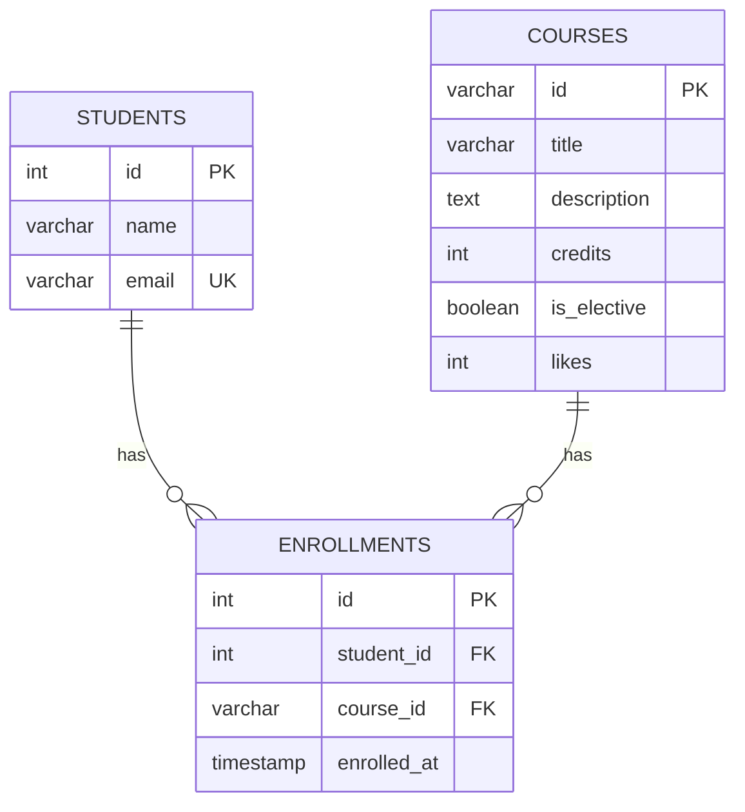

# Course Catalog Database

## Lab 6 — Design and Create the Catalog Database

This project contains the PostgreSQL database for the Course Catalog application.

The database stores:

- courses;
- students;
- enrollments.

It also demonstrates:

- primary and foreign keys;
- `NOT NULL`, `UNIQUE`, `CHECK`, and `DEFAULT` constraints;
- filtering, sorting, and pagination;
- joins and aggregate statistics;
- constraint violations and SQLSTATE codes;
- indexes and `EXPLAIN ANALYZE`;
- transactions and rollback.

---

## 1. Database Setup

A separate PostgreSQL role was created for the application:

```sql
CREATE ROLE catalog_app
WITH LOGIN
PASSWORD 'catalog123';
```

The database was created with this role as the owner:

```sql
CREATE DATABASE course_catalog
OWNER catalog_app;
```

Connection information:

```text
Database: course_catalog
Role: catalog_app
Host: localhost
```

---

## 2. Project Structure

```text
course-catalog-db/
├── schema.sql
├── seed.sql
├── queries.sql
├── part_5.sql
├── index_and_explain.sql
└── README.md
```

### Files

- `schema.sql` — creates the database tables and constraints.
- `seed.sql` — inserts the initial Course Catalog data.
- `queries.sql` — contains API-related queries, constraint tests, index tests, and transaction examples.
- `README.md` — database documentation.
- `part_5.sql` — constraint violation experiments and SQLSTATE codes.
- `index_and_explain.sql` — index creation and EXPLAIN ANALYZE comparison.
---

## 3. Database Schema

The database contains three tables:

### `courses`

Stores information about available courses.

```text
id
title
description
credits
is_elective
likes
```

Important constraints:

- `id` — Primary Key.
- `title` — `NOT NULL`.
- `description` — `NOT NULL`.
- `credits` — must be greater than `0`.
- `is_elective` — defaults to `FALSE`.
- `likes` — defaults to `0` and cannot be negative.

### `students`

Stores students.

```text
id
name
email
```

Important constraints:

- `id` — Primary Key.
- `name` — `NOT NULL`.
- `email` — `NOT NULL` and `UNIQUE`.

### `enrollments`

Connects students and courses.

```text
id
student_id
course_id
enrolled_at
```

Important constraints:

- `id` — Primary Key.
- `student_id` — Foreign Key to `students(id)`.
- `course_id` — Foreign Key to `courses(id)`.
- `enrolled_at` — defaults to the current timestamp.
- `(student_id, course_id)` — `UNIQUE`, so the same student cannot enroll in the same course twice.

---

## 4. ER Diagram



The relationship is:

```text
STUDENTS 1 ---- * ENROLLMENTS * ---- 1 COURSES
```

One student can enroll in many courses.

One course can contain many students.

`enrollments` is the junction table that implements the many-to-many relationship.

---

## 5. Initial Data

`seed.sql` inserts the six courses used by the Course Catalog application:

```text
Modern Frontend: React & Next.js
Backend Foundations: FastAPI
Relational Databases: PostgreSQL
API Design: REST vs GraphQL
Web Security Essentials
AI/LLM Integration
```

The seed file also creates several students and enrollments for testing joins and statistics.

To check the seeded courses:

```sql
SELECT *
FROM courses
ORDER BY likes DESC;
```

---

## 6. Queries for the API

### Get all courses

Equivalent to:

```text
GET /courses
```

```sql
SELECT *
FROM courses
ORDER BY likes DESC;
```

### Filter elective courses

Equivalent to:

```text
GET /courses?is_elective=true
```

```sql
SELECT *
FROM courses
WHERE is_elective = TRUE
ORDER BY likes DESC;
```

### Sort by title

Equivalent to:

```text
GET /courses?sort=title
```

```sql
SELECT *
FROM courses
ORDER BY title ASC;
```

### Pagination

Example:

```text
page = 2
page_size = 2
```

```sql
SELECT *
FROM courses
ORDER BY likes DESC
LIMIT 2
OFFSET 2;
```

`LIMIT` controls the number of returned rows.

`OFFSET` controls how many rows are skipped.

### Get one course

Equivalent to:

```text
GET /courses/web-security
```

```sql
SELECT *
FROM courses
WHERE id = 'web-security';
```

### Like a course

Equivalent to:

```text
POST /courses/web-security/like
```

```sql
UPDATE courses
SET likes = likes + 1
WHERE id = 'web-security'
RETURNING *;
```

### Create an enrollment

```sql
INSERT INTO enrollments (student_id, course_id)
VALUES (3, 'web-security')
RETURNING *;
```

---

## 7. JOIN Query

The following query combines all three tables:

```sql
SELECT
    e.id AS enrollment_id,
    s.name AS student_name,
    s.email,
    c.id AS course_id,
    c.title AS course_title,
    e.enrolled_at
FROM enrollments e
JOIN students s
    ON e.student_id = s.id
JOIN courses c
    ON e.course_id = c.id
ORDER BY e.id;
```

This query converts foreign key IDs into useful student and course information.

---

## 8. Statistics

### Number of students per course

```sql
SELECT
    c.id,
    c.title,
    COUNT(e.id) AS enrollment_count
FROM courses c
LEFT JOIN enrollments e
    ON c.id = e.course_id
GROUP BY c.id, c.title
ORDER BY enrollment_count DESC;
```

`LEFT JOIN` is used so that courses with zero enrollments are also returned.

### General course statistics

```sql
SELECT
    COUNT(*) AS total_courses,
    AVG(likes) AS average_likes,
    MAX(likes) AS maximum_likes,
    MIN(likes) AS minimum_likes
FROM courses;
```

---

## 9. Constraint Violation Experiments

Several invalid SQL operations were intentionally executed to test database integrity.

| Constraint | SQLSTATE | Suggested HTTP response |
|---|---|---|
| UNIQUE | `23505` | `409 Conflict` |
| NOT NULL | `23502` | `422 Unprocessable Entity` |
| CHECK | `23514` | `422 Unprocessable Entity` |
| FOREIGN KEY | `23503` | `409 Conflict` |
| Duplicate enrollment | `23505` | `409 Conflict` |

### UNIQUE violation

```sql
INSERT INTO students (name, email)
VALUES ('Duplicate Student', 'aigerim@example.com');
```

Result:

```text
SQLSTATE 23505
unique_violation
```

### NOT NULL violation

```sql
INSERT INTO students (name, email)
VALUES (NULL, 'null@example.com');
```

Result:

```text
SQLSTATE 23502
not_null_violation
```

### CHECK violation

```sql
INSERT INTO courses (
    id,
    title,
    description,
    credits
)
VALUES (
    'bad-course',
    'Bad Course',
    'Invalid credits',
    -5
);
```

Result:

```text
SQLSTATE 23514
check_violation
```

### FOREIGN KEY violation

```sql
INSERT INTO enrollments (student_id, course_id)
VALUES (9999, 'web-security');
```

Result:

```text
SQLSTATE 23503
foreign_key_violation
```

### Duplicate enrollment

```sql
INSERT INTO enrollments (student_id, course_id)
VALUES (1, 'web-security');
```

Result:

```text
SQLSTATE 23505
unique_violation
```

The database constraints protect the data even if invalid information reaches the database layer.

---

## 10. Index and EXPLAIN ANALYZE

The following query was selected for index testing:

```sql
SELECT *
FROM enrollments
WHERE course_id = 'web-security';
```

An index was created:

```sql
CREATE INDEX idx_enrollments_course_id
ON enrollments(course_id);
```

The execution plan was checked using:

```sql
EXPLAIN ANALYZE
SELECT *
FROM enrollments
WHERE course_id = 'web-security';
```

After creating the index PostgreSQL used:

```text
Bitmap Heap Scan on enrollments
→ Bitmap Index Scan on idx_enrollments_course_id
```

The observed execution plan showed that PostgreSQL used `idx_enrollments_course_id` to locate matching enrollment rows.

Example observed execution information:

```text
Planning Time: 0.244 ms
Execution Time: 0.374 ms
```

Indexes are especially useful when a table becomes large and queries frequently filter using an indexed column.

PostgreSQL may still choose a sequential scan for very small tables because its query planner estimates that reading the full table is cheaper.

---

## 11. Transaction and Rollback

A transaction was used to demonstrate atomicity.

First, a student was inserted:

```sql
BEGIN;

INSERT INTO students (name, email)
VALUES ('Rollback Student', 'rollback@test.com')
RETURNING id;
```

The student received an ID successfully.

Then an enrollment was intentionally created with a course that does not exist:

```sql
INSERT INTO enrollments (student_id, course_id)
VALUES (5008, 'course-does-not-exist');